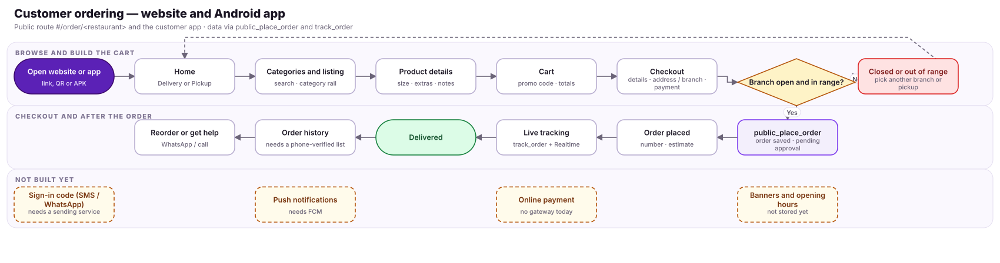
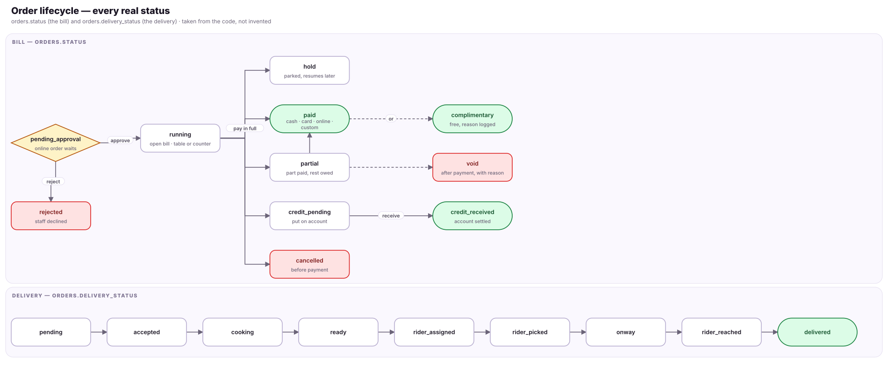
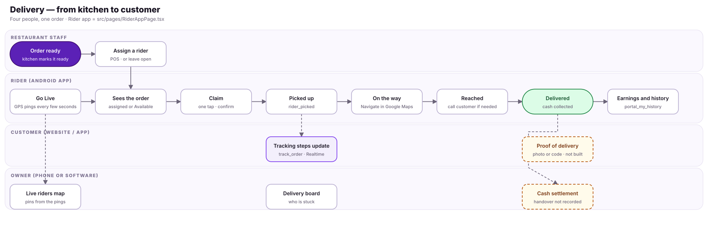
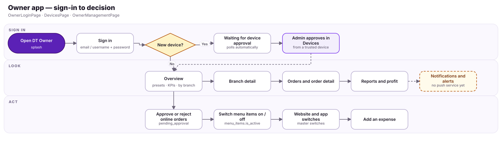
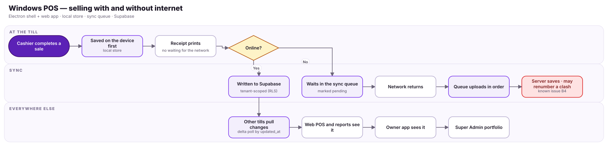
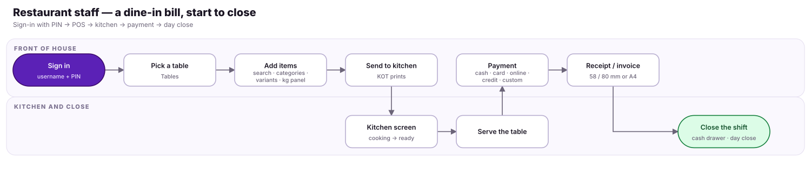

# User flows

## FLOW-01 — Customer ordering — the ordering website

Customers order on the website (no customer app). Guest checkout works today; a sign-in code and push notifications do not exist yet (dashed).

## FLOW-02 — Order lifecycle — every real status

Statuses are the ones the code uses (orders.status and orders.delivery_status). The arrows are the changes the screens perform; whether the database itself forbids other changes is NOT VERIFIED.

## FLOW-03 — Delivery — from kitchen to customer

Cash handover is not recorded by the system (the status change is). The customer sees the same status steps through track_order.

## FLOW-04 — Owner app — sign-in to decision

Device approval, forgot-password and the by-branch figures all exist today. Notifications are the one missing piece.

## FLOW-05 — Windows POS — selling with and without internet

The POS keeps working offline and syncs when online. Known issue B4 (docs/audit): when two tills reach the server with the same invoice number the server renumbers one; the fix is designed but not applied.

## FLOW-06 — Restaurant staff — a dine-in bill, start to close

The path the Windows POS redesign has to make fastest: five taps from a table to the kitchen, two from the kitchen to paid.
