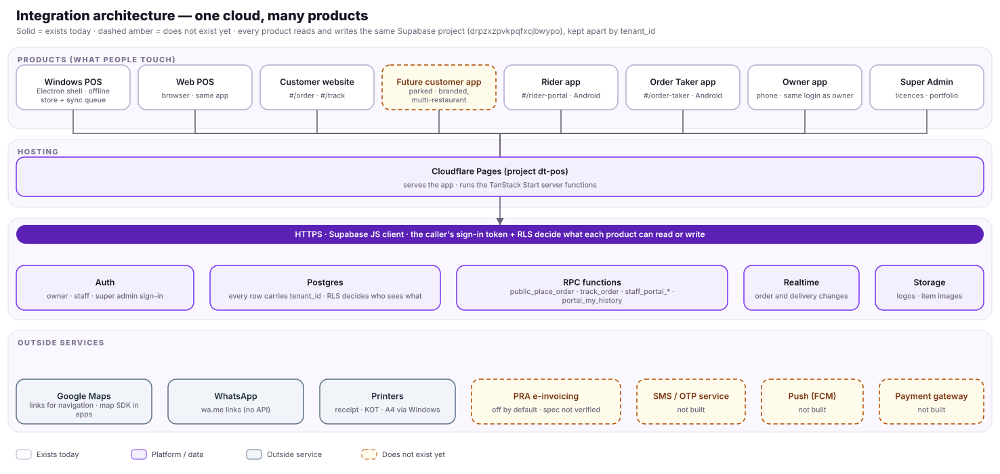

# Integration architecture

## Reading the diagram
- **One Supabase project** (`drpzxzpvkpqfxcjbwypo`) serves all products. Every table row carries `tenant_id`; row-level security decides what a signed-in person (or the anonymous website visitor) can read or write. The Super Admin sees across tenants; nobody else does.
- **Cloudflare Pages** (project `dt-pos`) serves the web app and runs the TanStack Start server functions. The Windows shell loads the same app through its `app://` protocol; the Android shells wrap the same web routes in Capacitor.
- **Public routes** (`#/order`, `#/track`, `#/rider-portal`, `#/order-taker`, `#/reset-password`) are the entry points of the website, the customer app, the rider app and the order-taker app. They skip the staff sign-in and use their own portal login or none (customers).
- **Calls that matter to the redesign:** `public_place_order` and `track_order` (customer), `staff_portal_*` and `portal_my_history` (rider / order taker), owner sign-in through Supabase Auth, orders/menu/inventory tables for the owner app.
- **Offline:** only the Windows POS (and the web POS in a browser) keeps a local copy and a sync queue — see FLOW-05. The customer, rider and owner apps need a connection; they show the last loaded data with a banner when offline.

## What does not exist (and the screens that wait for it)
| Missing piece | Needed by | Effect today |
|---|---|---|
| Push notifications (FCM) + a notifications table | Customer APP-18, Rider RID-06 (background) / RID-20, Owner OWN-18 | The app must be open to see anything |
| SMS / WhatsApp sending service + one-time code table | Customer APP-03/04, Rider RID-03 | Phone number + name only; riders use username + PIN |
| Online payment gateway | Checkout (WEB-12, APP-11) | Cash on delivery / pay at pickup only |
| Tenant banners, opening hours, social links | WEB-01/02, APP-05, OWN-20 | Hero banner and hours are placeholder slots |
| Verified-phone order list | WEB-15, APP-15 | Guest orders reachable only by tracking link |
| Proof of delivery, cash settlement | RID-13/14 | Status change only |
| Public offers list | WEB-17, APP-19 | Codes are typed at checkout |

## Security notes that affect the design
Open findings S2–S6 of `docs/audit/2026-10-30-security-findings.md` (HR/payroll visibility, settings writable by a cashier, cross-branch logs, customer PIN hashes, anonymous-executable functions) are **not** changed by this design. The owner app therefore does not show salaries, and write actions on the phone are limited to: approve/reject online orders, menu availability, expenses, device approval and the website switches.
